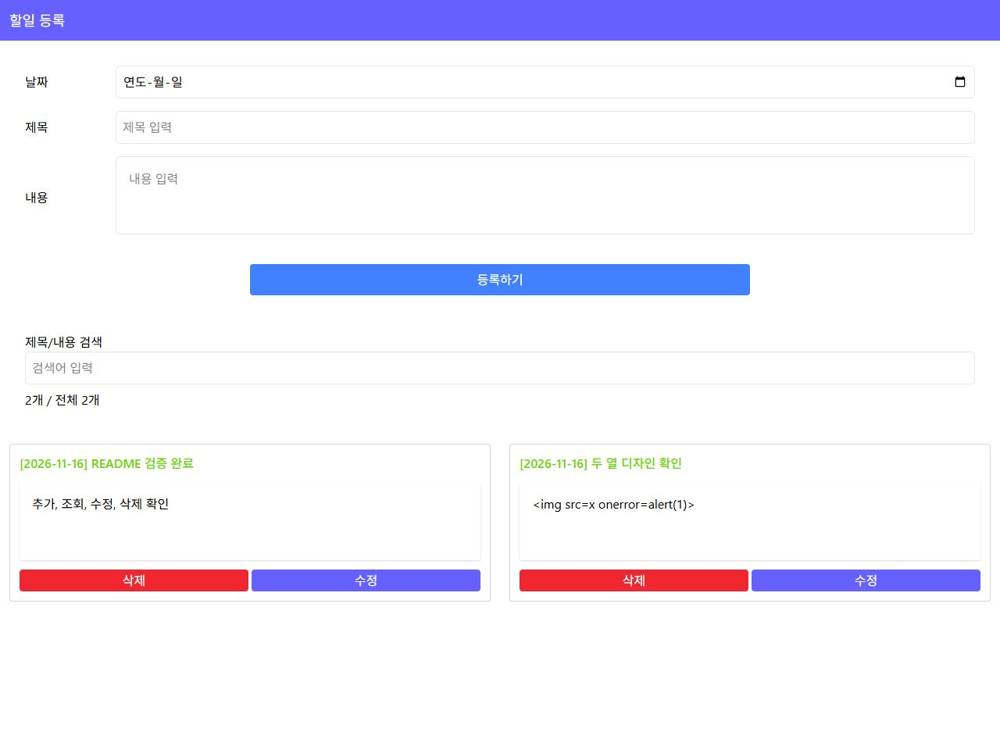

# JavaScript Todo

날짜, 제목, 내용을 입력해 할 일을 추가하고 검색, 수정, 삭제하는 CH2 과제다. 보라색 헤더와 데스크톱 두 열 카드 디자인, 기존 `todos` 저장 키와 숫자 UID 데이터 형식을 유지한다.

## 실행

[index.html](index.html)을 브라우저에서 연다. Tailwind CDN을 불러오므로 인터넷 연결이 필요하다. 파일 실행의 저장소 정책은 브라우저마다 다를 수 있어 로컬 HTTP 서버 사용을 권장한다.

```sh
python -m http.server 8023 --bind 127.0.0.1
```

같은 브라우저와 주소에서 `http://127.0.0.1:8023`에 접속한다. 계정이나 서버 동기화 없이 해당 출처의 localStorage에 저장한다.

## 구현과 데이터 흐름

| 파일 | 역할 |
| --- | --- |
| index.html | 입력 폼, 검색, 상태 메시지, 카드 템플릿 |
| css/style.css | 키보드 포커스, 긴 문자열 줄바꿈, 오류 표시 |
| js/todo.js | 배열 상태, CRUD, 저장소, DOM 렌더링, 이벤트 위임 |

`{ uid, date, title, content }` 객체 배열을 상태로 사용한다. 사용자 입력 → 검증 → 새 배열 계산 → localStorage 저장 → 메모리와 DOM 반영 순서다. 저장에 실패하면 기존 배열과 입력을 유지한다.

| 동작 | 핵심 로직 |
| --- | --- |
| 추가 | 기존 숫자 UID의 최댓값과 현재 시간을 고려해 중복 없는 ID 생성 |
| 조회 | find로 ID 조회, filter/includes로 제목과 내용 검색 |
| 수정 | map으로 같은 UID의 객체만 교체 |
| 삭제 | filter로 대상 UID 제외, 마지막 항목 삭제 시 빈 화면 갱신 |

카드 템플릿을 한 번 읽고 DocumentFragment에 새 카드를 모은 뒤 replaceChildren으로 반영한다. 목록 컨테이너에 클릭 리스너 하나만 연결하여 재렌더링 때 카드마다 이벤트를 다시 등록하지 않는다.

## 입력과 예외 처리

- 날짜, 제목, 내용의 빈 값과 공백만 있는 입력 차단.
- 제목 200자, 내용 4,000자 제한과 연결된 label 제공.
- 수정 취소, 수정 중인 항목 삭제 시 폼 초기화.
- 검색 결과 없음과 등록된 항목 없음 구분.
- 사용자 입력은 textContent로 출력. HTML 모양의 입력도 텍스트로 표시.
- 저장 공간/권한 오류는 role="alert"로 표시하고 기존 데이터를 유지.
- 깨진 JSON, 잘못된 행, 중복 UID를 발견하면 원래 저장값을 덮어쓰지 않음.
- 모바일에서는 카드 한 열, md 이상에서는 두 열.

## 브라우저 시연

[추가, 조회, 수정, 삭제 시연 영상 (WebM, 39.24초)](evidence/crud-demo.webm)

2026-11-16 기존 화면을 실제 브라우저에서 녹화한 영상이다. 입력/등록 → 검색 조회 → 수정 → 새로고침 → 삭제/빈 목록 흐름을 담고 있다. 이번 이벤트 위임 및 저장 실패 보완 전의 녹화이며, 보완 후 화면과 검증 범위는 아래에 구분했다.



## 확인 결과

```sh
node --test test/todo.test.cjs
```

2026-11-16 Node 테스트 4개 통과: 연속 추가 시 ID 중복 방지, 저장 실패 시 수정/삭제 미반영, 손상된 저장값 보존, CRUD와 재로딩 후 빈 목록 유지.

보완 후 실제 Chrome에서 추가, 제목 검색, 수정, 새로고침 후 유지, 두 열 카드와 HTML 모양 문자열의 텍스트 출력을 확인했다. 삭제 확인창에서 브라우저 제어 연결이 멈춰 보완 후 삭제 완료 화면은 재확인하지 못했다. 기존 영상의 삭제 시연과 이번 변경 후 검증 범위를 구분한다.

배열 복사와 문서 조각을 사용하지만 대량 데이터용 가상 목록이나 서버 저장은 구현하지 않았다. 여러 탭의 동시 편집 충돌 해결도 범위 밖이다.
